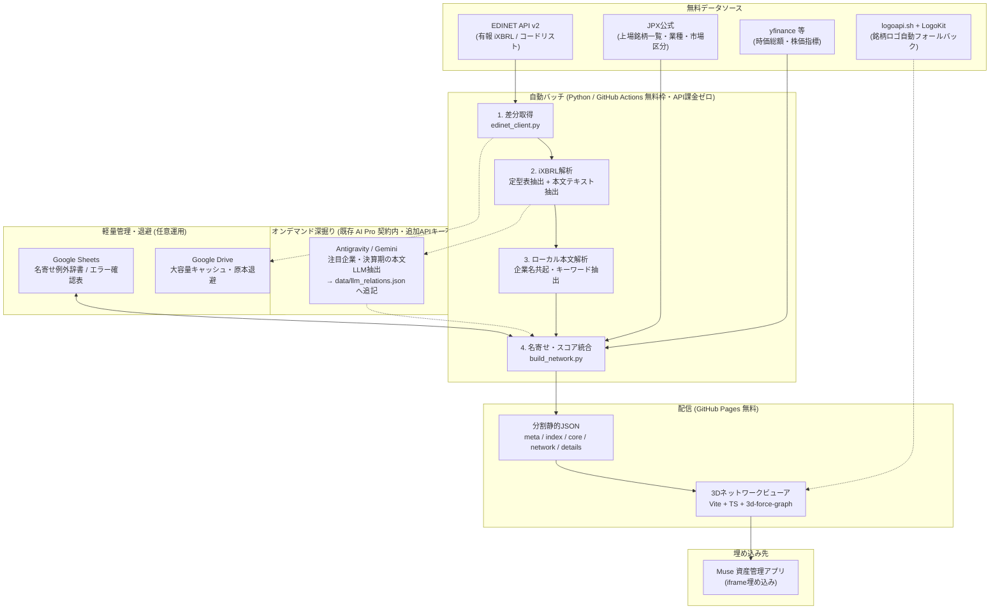

# Git_stock_networkmap 全体仕様書

## 1. プロジェクト概要・目的

EDINETの有価証券報告書（有報）から日本の上場企業間のつながり（主要顧客・政策保有株式・大株主・提携・供給網）を抽出し、**Muse内の資産管理アプリへ `<iframe>` で快適に埋め込める3D企業関係ネットワークマップ**を構築する。

### 最優先事項
1. **埋め込み最優先（Embed First）**：Muse資産管理アプリへ `<iframe>` 1枚で即座に組み込め、狭い枠内でもストレスなく操作できるスリムUI・快適UXを実現する。
2. **ランニングコスト完全無料（0円運用）**：ホスティング・データ取得・バッチ更新・ストレージすべてを無料枠で完結させる。
3. **全上場規模でも軽快（Zero-Lag）**：東証プライム〜全上場企業（約1,600〜3,800社）を対象としながら、分割静的JSONとオンデマンド描画により初期表示の遅延を防ぐ。

---

## 2. 設計合意サマリー（Design Decisions）

| 項目 | 決定事項 |
| --- | --- |
| **埋め込み先** | Muse内の資産管理アプリ（TypeScript製）へ `<iframe>` 埋め込み |
| **Muse連携レベル** | 単体で完結する独立 `iframe` を基本としつつ、任意の **URLクエリパラメータ**（`?embed=1`, `?focus=...`, `?holdings=...` 等）で保有銘柄ハイライト・初期フォーカス連携も可能にする |
| **埋め込みUI方針** | スリムUIを徹底しつつ全機能（検索・セクター絞込・サイズ切替・関係値スライダー・詳細パネル）を維持。さらに利便性を高めるUX改善（関係種別フィルタ、保有銘柄ハイライト、全画面切替等）を追加 |
| **対象銘柄規模** | 東証プライム〜全上場企業（約1,600〜3,800社）を最初から前提に設計。初期表示はコアハブ／保有銘柄周辺（1〜2ホップ）に絞り、検索で全上場企業へジャンプ可能にする |
| **関係性・抽出方式** | **定型表**（主要な顧客・政策保有株式・大株主）のルールベース自動抽出 ＋ **ローカルPython企業名共起抽出**（API不要・自動）＋ 必要に応じた **AI Pro（Antigravity/Gemini）オンデマンドLLM本文抽出** のハイブリッド構成（外部Gemini APIキー不使用） |
| **データ管理・基盤** | GASは不使用。**GitHub Pages（配信）＋ GitHub Actions（Python自動バッチ）＋ 無料データソース（EDINET / JPX / yfinance / LogoKitフォールバック）** を中核とし、Google Sheets／Driveは軽量な運用補助（名寄せ例外辞書・エラー確認・大容量キャッシュ退避）に限定 |
| **開発・Git運用** | 仕様書PRで合意後、機能ごとにブランチ＆PRを切って段階的にマージする |

---

## 3. システム全体アーキテクチャ

### GASを使わない理由
Google Apps Script（GAS）は1回の実行時間が最大6分と短く、3,800社分のXBRL解析・名寄せ・JSON生成には不向きで保守箇所も分散する。Python＋GitHub Actions（パブリックリポジトリ無料枠）に一本化することで、ローカル実行と自動実行を同じコードで運用でき、障害切り分けも容易になる。

---

## 4. 開発ロードマップ（フェーズ別PR計画）

| Phase | ブランチ例 | 主な成果物 | ゴール |
| --- | --- | --- | --- |
| **Phase 1（完了）** | `docs/architecture-spec` | `docs/` 配下の仕様書一式 | 全体設計・スキーマ・UI・運用方針の合意 |
| **Phase 2（埋め込み最優先）** | `feat/embed-slim-ui` | `?embed=1` スリムUI、`?focus`/`?holdings`/`?hops` 対応、関係種別フィルタ、LogoKitフォールバック、分割JSONローダ、全画面切替 | **Museアプリへiframe埋め込み＆実画面テスト完了** |
| **Phase 3（全上場・自動バッチ）** | `feat/edinet-full-pipeline` | JPX/EDINETマスタ自動取得、iXBRL定型表パーサ（主要顧客・政策保有・大株主）、ローカル本文共起抽出、自動名寄せ、`yfinance`時価総額、分割JSON出力、GitHub Actions定期実行 | 全上場企業の実データ自動生成＆Pages配信 |
| **Phase 4（AI Pro連携・運用管理）** | `feat/ai-pro-and-ops` | AI Pro（Antigravity/Gemini）向けオンデマンド本文抽出ワークフロー＆`llm_relations.json`マージ機構、Google Sheets例外辞書＆抽出エラーログ連携 | 定型表＋ローカル解析＋AI Pro深掘りの完全無料運用 |

---

## 5. セキュリティ・Git運用ルール

1. **シークレット管理**
   - `EDINET_API_KEY` は絶対にコードやリポジトリへ含めない（ローカルは `.env`、自動バッチは GitHub Actions Secrets へ登録）。
   - LogoKit の公開クライアントトークン（`VITE_LOGOKIT_TOKEN`）を利用する場合は、LogoKit管理画面で配信ドメイン（`asoka501.github.io`）制限を設定したうえで GitHub Repository Variables へ登録する。
   - 外部の `GEMINI_API_KEY` は発行・使用しない。
2. **生XBRLの扱い**
   - ダウンロードした `.zip` や展開済み生XBRL（`data/raw/`）はリポジトリへコミットしない（`.gitignore` 済み）。
3. **ブランチ・PR運用**
   - `main` へ直接プッシュせず、必ず機能ブランチ（`docs/*`, `feat/*`, `fix/*`）を作成し、PR経由で差分・ビルド確認後にマージする。
   - `main` マージ時に [pages.yml](../.github/workflows/pages.yml) により GitHub Pages へ自動反映される。

---

## 6. 関連ドキュメント

- [EMBED_UI_SPEC.md](./EMBED_UI_SPEC.md) — iframe埋め込み・URLパラメータ・スリムUI・大規模描画仕様
- [DATA_SCHEMA_AND_PIPELINE.md](./DATA_SCHEMA_AND_PIPELINE.md) — 分割JSONスキーマ・EDINET/LLMパイプライン・無料バッチ運用仕様
