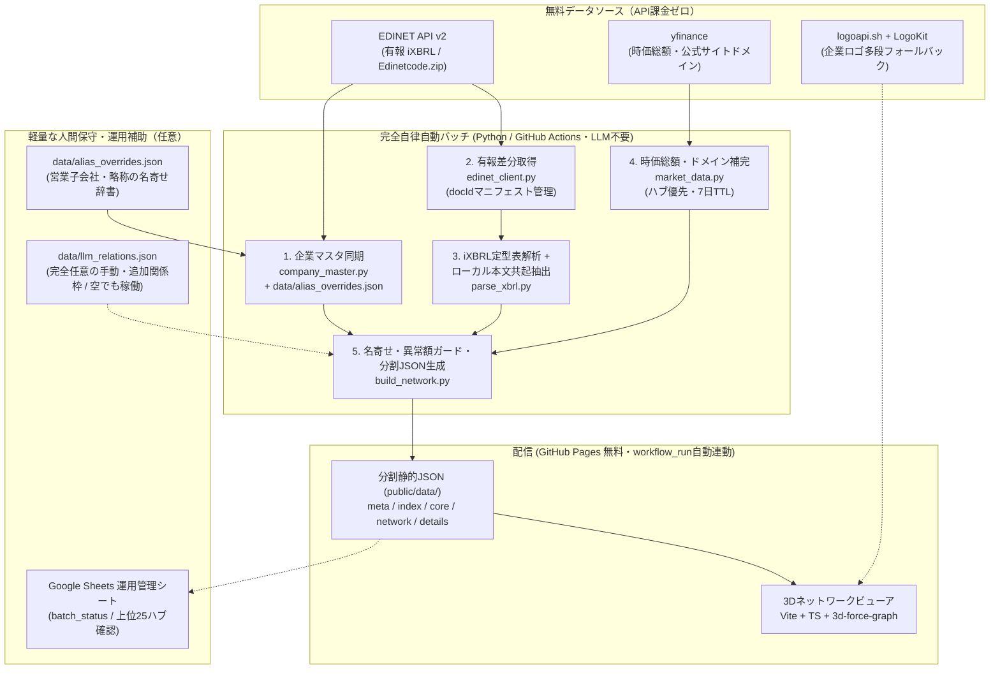

# Git_stock_networkmap 全体仕様書

## 1. プロジェクト概要・目的

EDINETの有価証券報告書（有報）から日本の上場企業間のつながり（政策保有株式・大株主・主要顧客・資本業務提携・共同開発・供給網リスク）を自動抽出し、**全上場企業（約3,800社）の企業関係網をブラウザ上で直感的に探索できる3Dネットワークマップ**を構築・運用する。

### 設計の基本原則
1. **LLM非依存・完全自律保守（No-LLM-Required）**：定期データ取得・iXBRL解析・本文共起抽出・企業名名寄せ・時価総額/ドメイン補完・Pages公開まで、**外部LLMやAIエージェントを一切介さず決定論的なコードだけで完結・長期保守できる構造**を必須要件とする。
2. **ランニングコスト完全無料（0円運用）**：ホスティング・データ取得・バッチ更新・ロゴ補完・運用管理すべてを無料枠で完結させる。
3. **全上場規模でも軽快（Zero-Lag）**：全上場約3,800社を対象としながら、分割静的JSON（`meta` / `index` / `core` / `network` / `details`）とWebGL LOD制御により初回表示の遅延を防ぐ。
4. **視覚的識別性と探索性**：人間が一度に識別できる11カテゴリ大分類配色とズーム連動33業種近似色、企業ロゴ多段フォールバック、1〜2ホップ段階展開により「毛玉化」を防ぎつつ芋づる式分析を可能にする。

---

## 2. 設計合意サマリー（Design Decisions）

| 項目 | 決定事項（本番稼働中） |
| --- | --- |
| **提供形態** | GitHub Pages 上で単体完結する静的3D Webアプリ（`https://asoka501.github.io/Git_stock_networkmap/`）。任意のURLクエリ（`?embed=1`, `?focus=...`, `?holdings=...`, `?hops=...` 等）によるコンパクト表示・状態共有にも対応 |
| **対象銘柄規模** | 全上場企業（インデックス 3,856社／接続ノード 3,791社／エッジ 28,021本）。初期表示は主要ハブ上位180社（`core.json`）に絞り、全社検索・範囲切替時に `network.json`・`details/*.json` を遅延読込 |
| **関係性・抽出方式** | **① iXBRL定型表ルールベース抽出**（政策保有株式・大株主・主要顧客）＋ **② ローカルPython企業名共起抽出**（提携・共同開発・供給網）の完全自動・LLM不要パイプライン。`data/llm_relations.json` は存在時のみ統合する完全任意の拡張枠（空配列のままでも機能欠損なし） |
| **配色設計** | 11カテゴリ大分類パレット（金融・素材重工・半導体電機・自動車モビリティ・消費医薬食品・不動産建設・商社エネルギー・通信IT・倉庫運輸・サービス業・その他）＋ズームイン時のJPX 33業種近似色グラデーション |
| **ロゴ補完** | `logoapi.sh/ticker/{code}.svg` → `logoapi.sh/{domain}` → `LogoKit`（Domain / Ticker）→ 略称イニシャルバッジの多段フォールバック（Canvas 2D および詳細一覧の `20×20px` ミニロゴ共通） |
| **データ管理・基盤** | GAS不使用。**GitHub Pages（配信）＋ GitHub Actions（Python定期バッチ＆キャッシュ）＋ 無料ソース（EDINET API v2 / `yfinance` / `logoapi.sh` / LogoKit）** を中核とし、Google Sheets は軽量な運用ダッシュボード・名寄せメモ補助に限定 |
| **開発・Git運用** | コード変更は必ず機能ブランチ＆PR経由でマージ。`public/data/` の定期データ更新のみ GitHub Actions が `main` へ自動コミットし、`workflow_run` で Pages へ自動デプロイ |

---

## 3. システム全体アーキテクチャ

### GAS・外部LLM APIを使わない理由
- **GAS不使用の理由**：Google Apps Scriptは1回最大6分の実行制限があり、3,800社規模のXBRL解析・名寄せ・分割JSON生成には不向きで保守箇所も分散する。Python＋GitHub Actions（パブリックリポジトリ無料枠）へ一本化することで、ローカル実行・単体テスト・自動実行を同一コードベースで保守できる。
- **外部LLM API不使用の理由**：有報の企業関係は定型表（政策保有株式・大株主・主要顧客）とローカル本文共起ルールだけで全上場3,791社・28,021本を再現性高く自動抽出できる。LLMへの依存を排除することで、API仕様変更・モデル廃止・課金・ハルシネーションによる保守破綻を防ぎ、標準的なPythonコードの保守だけで長期運用できる。

---

## 4. 実装完了フェーズ実績

| フェーズ / PR | 主な実装内容 | 状態 |
| --- | --- | --- |
| **Phase 1（PR #2）** | `docs/` 仕様書一式の策定・アーキテクチャ合意 | 完了 |
| **Phase 2（PR #3）** | 分割JSONローダ、URLクエリ連携（`?embed=1`, `focus`, `holdings`, `hops` 等）、関係種別・出典フィルタ、全画面切替、多段ロゴローダ | 完了 |
| **Phase 3（PR #4, #5）** | EDINET API v2 正式対応、`Edinetcode.zip` 主系企業マスタ、iXBRL定型表＋ローカル本文共起パーサ、`yfinance` 時価総額・ドメイン補完、GitHub Actions 週次自動更新ワークフロー | 完了 |
| **Phase 4（PR #6）** | 結合セル（`colspan`/`rowspan`）＆列別通貨単位パーサ精度改善、ハブ優先時価総額更新、営業子会社名寄せ辞書（41件）、`workflow_run` Pages自動デプロイ連動、Google Sheets運用管理シート構築 | 完了 |
| **UI・データ品質強化（PR #7, #8, #9）** | 11大分類カラーパレット＋ズーム連動33業種近似色、`logoapi.sh/{domain}` 追加＆Canvas CORS修正、業種表記揺れ正規化、詳細パネル関係企業ミニロゴ表示、旧キャッシュ異常額ガード | 完了 |
| **全上場12ヶ月バックフィル** | `2025-12-01`〜`2026-11-23` 全決算期3,750有報パース完走（接続3,791社・エッジ28,021本・時価総額/ドメイン補完率96.4〜96.6%） | 完了 |

---

## 5. セキュリティ・Git運用ルール

1. **シークレット管理**
   - `EDINET_API_KEY`（必須・無料）：絶対にコードやリポジトリへ含めない。ローカルは環境変数（または `.gitignore` 済み `.env`）、自動バッチは GitHub Repository Secrets へ登録する。
   - `VITE_LOGOKIT_TOKEN`（任意・無料枠）：LogoKit管理画面で配信ドメイン（`asoka501.github.io`）制限を設定し、GitHub Repository Secrets へ登録する。未設定でも `logoapi.sh` → 略称バッジで問題なく動作する。
   - 外部の `GEMINI_API_KEY` 等のLLM APIキーは発行・使用しない。
2. **生XBRL・キャッシュの扱い**
   - ダウンロードした `.zip` や展開済み生XBRL・中間キャッシュ（`data/raw/`, `data/cache/`）はリポジトリへコミットしない（`.gitignore` 済み）。Actionsでは `actions/cache@v4` で中間キャッシュのみ保持する。
3. **ブランチ・PR運用**
   - コード・設定・ドキュメントの変更は `main` へ直接プッシュせず、必ず機能ブランチ（`docs/*`, `feat/*`, `fix/*`）からPR経由でビルド・テスト確認後にマージする。
   - `main` マージおよび `Update EDINET Network Data` 成功時に [.github/workflows/pages.yml](../.github/workflows/pages.yml) により GitHub Pages へ自動反映される。

---

## 6. 関連ドキュメント

- [EMBED_UI_SPEC.md](./EMBED_UI_SPEC.md) — フロントエンドUI/UX・11セクター配色・ロゴ多段フォールバック・URLクエリ仕様
- [DATA_SCHEMA_AND_PIPELINE.md](./DATA_SCHEMA_AND_PIPELINE.md) — 分割JSONスキーマ・EDINET自動パイプライン詳細・LLM非依存の長期保守手順
